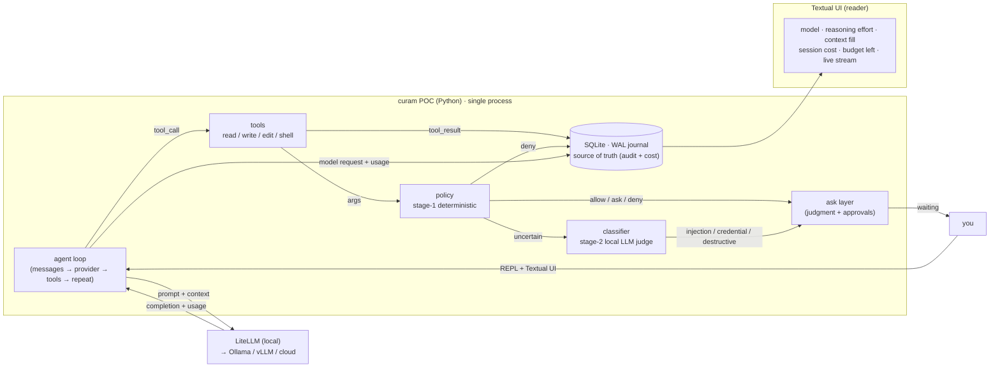
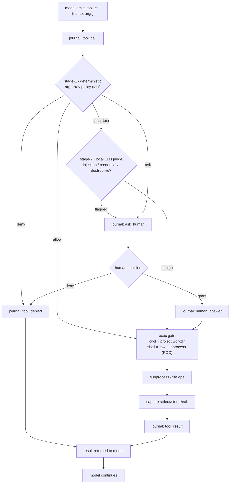
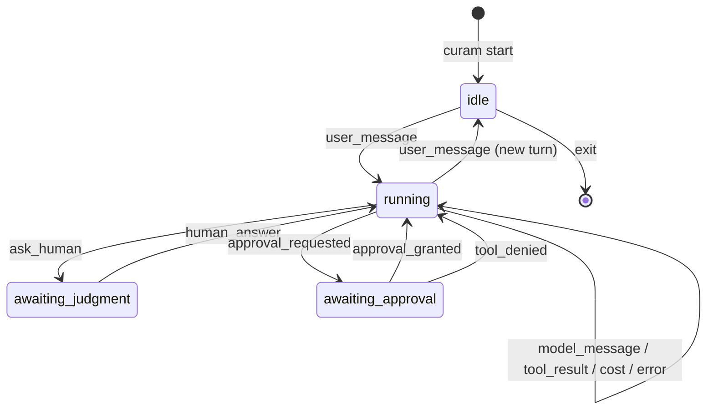
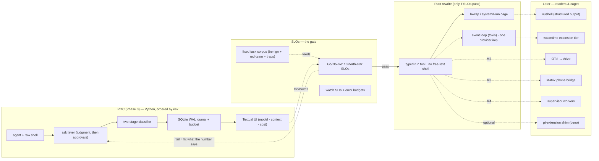
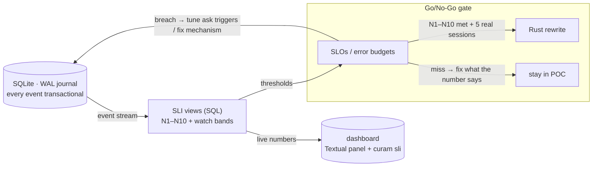

# curam — Work Diagrams

Mermaid diagrams for the curam design. Render on GitHub, VSCode (Mermaid
Preview), or `docs/curam.md`'s adjacent tooling. Updated for the POC-first
(Python) plan and the SLO/SLI framework.

## 1. Architecture Overview — POC (Python)

The session journal is the hub. Everything reads from it; nothing writes back
except the agent loop itself. SLOs are SQL views over the journal.

## 2. Tool-Call Path (Classifier + Ask)

Two-tier classification: deterministic arg-array policy on every call, tiny
local LLM judge only on the uncertain remainder. Asks are for *judgment*, not
just permission.

## 3. Session Lifecycle (Event States)

## 4. What We Build Now vs Later

POC (Python, throwaway) proves the risky bits; the journal schema and SLOs
survive into the Rust rewrite.

## 5. SLO Feedback Loop

The journal is the instrument; every SLI is one SQL view over it; the
dashboard and error budgets read the same views.

